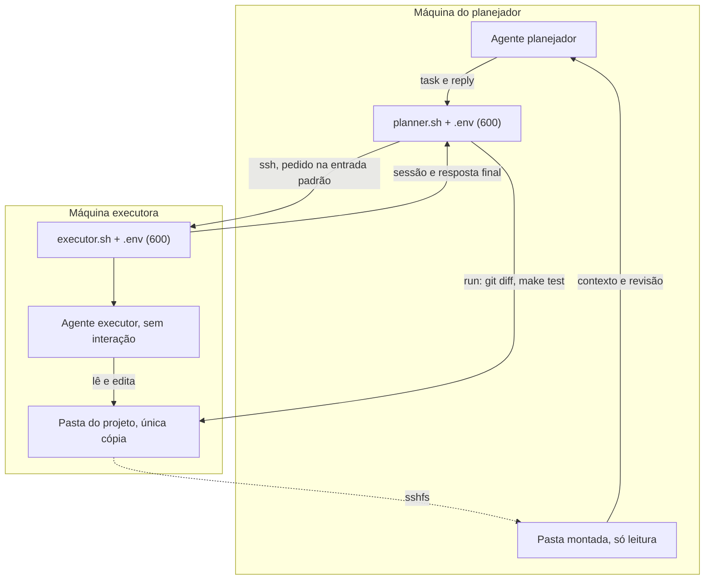
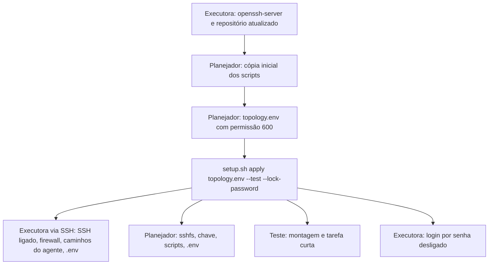

# Ponte entre agentes: planejador e executor

Dois agentes de código trabalham em máquinas diferentes. O **planejador** escreve cada tarefa, envia por SSH, lê o projeto por uma pasta montada com `sshfs` e revisa rodando comandos pela mesma conexão. O **executor** implementa, na única cópia do projeto. Na máquina executora nada do planejador é instalado.

Hoje o planejador é o Claude Code e o executor é o Codex CLI, mas os nomes dos arquivos, dos comandos e das variáveis não dependem disso. Só dois pontos são do Codex, porque é ele quem os lê: o binário padrão `codex`, com `codex exec`, e a variável `CODEX_HOME`, preenchida por `AGENT_HOME_DIR`.

Toda a configuração fica num `.env` com permissão 600 em cada máquina. Os scripts recusam o arquivo se a permissão não for 600 ou se ele não pertencer ao usuário que roda o script.



## Por que não MCP

O Codex removeu o comando `codex mcp-server` na versão 0.154.0. O substituto oficial, o app server, fala um protocolo próprio, e o plugin do Codex para o Claude Code exige os dois na mesma máquina. Por isso a ponte usa o `codex exec`, o modo sem interação, que devolve a resposta final e o identificador da sessão para continuar a conversa.

## Arquivos

| Arquivo | Onde roda | Para quê |
| --- | --- | --- |
| `AGENTS.md` | executora | Regras do projeto e formato da resposta para o executor |
| `tools/agent-bridge/executor.sh` | executora | Carrega o `.env`, entra no projeto e roda o agente sem interação, uma tarefa por vez |
| `tools/agent-bridge/planner.sh` | planejador | Envia tarefas, continua sessões, roda comandos de revisão e monta a pasta |
| `tools/agent-bridge/setup.sh` | planejador e executora | Instala e remove a ponte: `apply` e `remove` a partir da topologia, ou cada máquina sozinha |
| `tools/agent-bridge/lib.sh` | as duas | Leitura do `.env` sem executá-lo e checagem da permissão |
| `tools/agent-bridge/.env.example` | as duas | Modelo do `.env`, com as variáveis das duas máquinas |
| `tools/agent-bridge/topology.env.example` | planejador | Modelo da topologia: qual máquina executa e como chegar nela |

O `.env` e a topologia são lidos literalmente: sem expansão de `$VARIAVEL` e sem comentário depois do valor. Use caminhos absolutos; só `~` no início é aceito nos caminhos locais.

## 1. Instalação a partir da topologia

Tudo roda do planejador. O arquivo `topology.env` diz qual máquina executa e como chegar nela; o `setup.sh apply` entra na executora por SSH, prepara as duas máquinas e confere o resultado.



**Pré-requisitos na executora**, uma vez só, porque sem eles o planejador não tem como entrar:

```bash
sudo apt install -y openssh-server
cd ~/radar-finance && git pull     # o repositório precisa ter a ponte e o AGENTS.md
codex login                         # o login do agente é feito na própria máquina
```

**No planejador:**

```bash
# 1. Cópia inicial dos scripts (pede a senha da executora)
ssh usuario@ip-da-executora 'tar --exclude=agent-bridge/.env --exclude=agent-bridge/.state -C /home/usuario/radar-finance/tools -cf - agent-bridge' | tar -C ~ -xf -

# 2. Topologia
cd ~/agent-bridge
cp topology.env.example topology.env && chmod 600 topology.env
nano topology.env                   # EXECUTOR_HOST, EXECUTOR_SSH_USER e EXECUTOR_REPO_DIR

# 3. Instalação, teste e senha desligada
./setup.sh apply topology.env --test --lock-password
```

O `apply`:

1. confere se a executora responde na porta SSH;
2. cria a chave `~/.ssh/radar_executor`, se não existir, e a autoriza na executora, pedindo a senha uma única vez;
3. roda o setup da executora pelo SSH, que pode pedir a senha do `sudo` lá: liga o SSH, libera a porta 22 só para a rede local se o `ufw` estiver ativo, encontra `codex`, `go`, `pnpm` e `node` pelo `PATH` do shell interativo e cria o `.env` dela;
4. grava na executora as opções `AGENT_*` da topologia;
5. prepara o planejador: `sshfs`, cópia atualizada dos scripts e `.env`;
6. roda o `planner.sh check`;
7. com `--test`, monta a pasta e roda uma tarefa curta;
8. com `--lock-password`, desliga o login por senha e confere que a chave continua entrando.

Pode ser rodado de novo a qualquer momento, por exemplo para atualizar os scripts do planejador depois de um `git pull` na executora. Ele só completa o que falta e respeita o que você editou à mão nos `.env`.

Se faltar `go` ou `pnpm` na executora, instale-os nas versões do `.devcontainer` e rode o `apply` de novo. Se a executora for o WSL de um Windows, o setup mostra os comandos do PowerShell para a rede espelhada e o firewall do Windows.

### Instalação máquina a máquina

Para preparar cada máquina separadamente, sem topologia: `tools/agent-bridge/setup.sh executor` na executora (mostra no fim os comandos para o planejador), `setup.sh planner usuario@host` no planejador e `tools/agent-bridge/setup.sh lock-password` na executora.

## 2. Remoção

```bash
~/agent-bridge/setup.sh remove ~/agent-bridge/topology.env
```

O `remove` desfaz só o que a ponte fez, guiado pelo registro `.state` (permissão 600) que o setup grava em cada máquina:

- **Executora:** retira a chave do planejador do `authorized_keys`, remove a regra do `ufw` criada pelo setup, volta o login por senha ao padrão, apaga o `.env` e o `.state` e desinstala o `openssh-server` só se foi o setup que o instalou.
- **Planejador:** desmonta a pasta, apaga a chave só se foi o setup que a criou, tira a executora do `known_hosts`, desinstala o `sshfs` só se foi o setup que o instalou e apaga os scripts e o `.env`.

Ficam intactos o agente, o login dele, o repositório (os scripts nele são versionados) e o próprio `topology.env`. Com `--skip-executor`, remove só do planejador; na executora, o equivalente local é `tools/agent-bridge/setup.sh executor-remove`.

## 3. Opcional: chave só para as tarefas

Para que a chave usada nas tarefas não abra um shell na máquina executora:

1. Gere uma segunda chave, por exemplo `~/.ssh/radar_executor_tools`, e autorize-a normalmente. Ela serve para o `run` e o `mount`.
2. Na máquina executora, em `~/.ssh/authorized_keys`, coloque antes da chave das tarefas: `command="/caminho/do/projeto/tools/agent-bridge/executor.sh",restrict`.
3. No `.env` da máquina do planejador: `EXECUTOR_SSH_KEY` com a chave restrita e `EXECUTOR_SSH_TOOLS_KEY` com a segunda.

Com isso, a chave restrita só consegue rodar `exec`, `resume <sessão>` e `--check`. Qualquer outro comando recebe a mensagem de uso.

## 4. Uso

```bash
# Tarefa nova: o pedido vai num arquivo local ou pela entrada padrão
~/agent-bridge/planner.sh task /tmp/pedido-0012.md

# Continuar a mesma sessão com uma correção
~/agent-bridge/planner.sh reply <sessão> /tmp/correcao-0012.md

# Revisão, sempre na máquina executora
~/agent-bridge/planner.sh run git status --short
~/agent-bridge/planner.sh run git diff
~/agent-bridge/planner.sh run make test
~/agent-bridge/planner.sh run make lint
```

O `task` e o `reply` respondem com três partes: `sessão: <id>`, `código de saída: <n>` e a resposta final do agente. Se não houver resposta final, aparecem os últimos erros. Só uma tarefa roda por vez: uma segunda chamada enquanto a primeira trabalha é recusada.

O `run` passa cada argumento literalmente, sem pipes nem `&&`.

No Claude Code, um comando de terminal pode durar no máximo 10 minutos. Para tarefas maiores, o planejador roda o `task` em segundo plano e lê o resultado quando ele termina.

No modo `workspace-write`, o sandbox do executor costuma bloquear a rede. Deixe as dependências instaladas antes (`make setup`) ou libere a rede na configuração do agente.

### Modelo de pedido ao executor

```markdown
Tarefa: <título curto> (<códigos RF/RN>)

Leia: CLAUDE.md, docs/requisitos.md seção <n>, <arquivos>.
Altere só: <arquivos>.

Passos:
1. <passo>
2. <passo>

Casos de teste (tabela em go test):
| entrada | esperado |
| ... | ... |

Fora do escopo: <o que não fazer>.

Pronto quando: make test e make lint passam. Responda no formato do AGENTS.md.
```

## 5. O que fica na máquina executora

- Processos do `sshd`, do agente, do `sftp-server` (da montagem) e dos comandos que o agente e o `run` executam.
- Logs do SSH.
- O histórico das sessões do agente (em `~/.codex/sessions/`, ou em `AGENT_HOME_DIR`), com todos os pedidos enviados pelo planejador.
