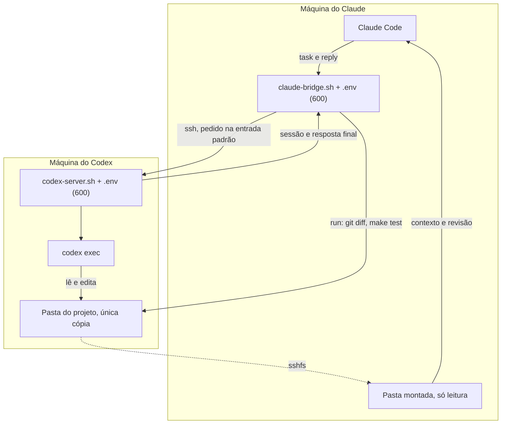

# Claude planeja, Codex executa

O Claude Code roda numa máquina e o Codex em outra. O Claude envia cada tarefa ao Codex por SSH, lê o projeto por uma pasta montada com `sshfs` e revisa rodando comandos pela mesma conexão. Na máquina do Codex nada do Claude é instalado.

Toda a configuração fica num `.env` com permissão 600 em cada máquina. Os scripts recusam o arquivo se a permissão não for 600 ou se ele não pertencer ao usuário que roda o script.

## Por que não MCP

O Codex removeu o comando `codex mcp-server` na versão 0.154.0. O substituto oficial, o app server, fala um protocolo próprio, e o plugin do Codex para o Claude Code exige o Codex instalado na mesma máquina do Claude. Por isso a ponte usa o `codex exec`, o modo sem interação do Codex, que devolve a resposta final e o identificador da sessão para continuar a conversa.



## Arquivos

| Arquivo | Onde roda | Para quê |
| --- | --- | --- |
| `AGENTS.md` | Codex | Regras do projeto e formato da resposta para o Codex |
| `tools/codex-bridge/codex-server.sh` | Codex | Carrega o `.env`, entra no projeto e roda `codex exec`, uma tarefa por vez |
| `tools/codex-bridge/claude-bridge.sh` | Claude | Envia tarefas, continua sessões, roda comandos de revisão e monta a pasta |
| `tools/codex-bridge/lib.sh` | as duas | Leitura do `.env` sem executá-lo e checagem da permissão |
| `tools/codex-bridge/.env.example` | as duas | Modelo do `.env`, com as variáveis das duas máquinas |

O `.env` é lido literalmente: sem expansão de `$VARIAVEL` e sem comentário depois do valor. Use caminhos absolutos; só `~` no início é aceito nos caminhos locais.

## 1. Máquina do Codex

Os passos supõem o PC com Windows e o projeto no WSL, como a produção.

| Passo | Como fazer | Feito |
| --- | --- | --- |
| Codex instalado e autenticado | No WSL, `codex login` com a conta do ChatGPT, ou o modelo local configurado em `~/.codex/config.toml` | [ ] |
| Servidor SSH no WSL | `sudo apt install openssh-server` e `sudo systemctl enable --now ssh` | [ ] |
| WSL visível na rede local | Em `%UserProfile%\.wslconfig`, seção `[wsl2]`, a linha `networkingMode=mirrored`; depois `wsl --shutdown` no PowerShell | [ ] |
| Firewall | No PowerShell como administrador: `New-NetFirewallRule -DisplayName "Radar SSH Codex" -Direction Inbound -Protocol TCP -LocalPort 22 -Profile Private -Action Allow` | [ ] |
| `.env` | `cp tools/codex-bridge/.env.example tools/codex-bridge/.env`, `chmod 600 tools/codex-bridge/.env` e preencher a parte "Codex machine" | [ ] |
| Teste local | `tools/codex-bridge/codex-server.sh --check` mostra a pasta, a versão e o login do Codex, e `ok` para go, pnpm, node, make, git e flock | [ ] |

Se a conexão da outra máquina não chegar ao WSL mesmo com a rede espelhada, confira na documentação do WSL as regras de firewall do Hyper-V para a rede espelhada.

Numa sessão SSH sem terminal, o `.bashrc` do Ubuntu para logo no início, então o `PATH` do nvm, do Go e do pnpm pode não existir. Por isso o `.env` tem `CODEX_BIN` e `CODEX_PATH_EXTRA`.

## 2. Máquina do Claude

Precisa de bash, cliente SSH, `sshfs` e Claude Code. O `sshfs` é nativo no Linux, pede o macFUSE no macOS e, no Windows, fica mais simples dentro do WSL.

| Passo | Como fazer | Feito |
| --- | --- | --- |
| Chave SSH | `ssh-keygen -t ed25519 -f ~/.ssh/radar_codex -C radar-codex`. Sem senha, ou com senha guardada no `ssh-agent` | [ ] |
| Autorizar a chave | `ssh-copy-id -i ~/.ssh/radar_codex.pub usuario@maquina-codex` | [ ] |
| Copiar os scripts | `scp -r usuario@maquina-codex:/caminho/do/projeto/tools/codex-bridge ~/codex-bridge` | [ ] |
| `.env` | `cp ~/codex-bridge/.env.example ~/codex-bridge/.env`, `chmod 600 ~/codex-bridge/.env` e preencher a parte "Claude machine" | [ ] |
| Conferir | `~/codex-bridge/claude-bridge.sh check` | [ ] |
| Montar a pasta | `~/codex-bridge/claude-bridge.sh mount` | [ ] |

Abra o Claude Code dentro da pasta montada (`~/radar-codex` por padrão). Assim ele lê o `CLAUDE.md` e o restante do projeto direto da máquina do Codex.

## 3. Opcional: chave só para as tarefas

Para que a chave usada nas tarefas não abra um shell na máquina do Codex:

1. Gere uma segunda chave, por exemplo `~/.ssh/radar_codex_tools`, e autorize-a normalmente. Ela serve para o `run` e o `mount`.
2. Na máquina do Codex, em `~/.ssh/authorized_keys`, coloque antes da chave das tarefas: `command="/caminho/do/projeto/tools/codex-bridge/codex-server.sh",restrict`.
3. No `.env` da máquina do Claude: `CODEX_SSH_KEY` com a chave restrita e `CODEX_SSH_TOOLS_KEY` com a segunda.

Com isso, a chave restrita só consegue rodar `exec`, `resume <sessão>` e `--check`. Qualquer outro comando recebe a mensagem de uso.

## 4. Uso

```bash
# Tarefa nova: o pedido vai num arquivo local ou pela entrada padrão
~/codex-bridge/claude-bridge.sh task /tmp/pedido-0012.md

# Continuar a mesma sessão com uma correção
~/codex-bridge/claude-bridge.sh reply <sessão> /tmp/correcao-0012.md

# Revisão, sempre na máquina do Codex
~/codex-bridge/claude-bridge.sh run git status --short
~/codex-bridge/claude-bridge.sh run git diff
~/codex-bridge/claude-bridge.sh run make test
~/codex-bridge/claude-bridge.sh run make lint
```

O `task` e o `reply` respondem com três partes: `sessão: <id>`, `código de saída: <n>` e a resposta final do Codex. Se não houver resposta final, aparecem os últimos erros. Só uma tarefa roda por vez: uma segunda chamada enquanto a primeira trabalha é recusada.

O `run` passa cada argumento literalmente, sem pipes nem `&&`.

No Claude Code, um comando de terminal pode durar no máximo 10 minutos. Para tarefas maiores, o Claude roda o `task` em segundo plano e lê o resultado quando ele termina.

No modo `workspace-write`, o sandbox do Codex costuma bloquear a rede. Deixe as dependências instaladas antes (`make setup`) ou libere a rede na configuração do Codex.

### Modelo de pedido ao Codex

```markdown
Tarefa: <título curto> (<códigos RF/RN>)

Leia: CLAUDE.md, docs/requisitos.md seção <n>, <arquivos>.
Altere só: <arquivos>.

Passos:
1. <passo>
2. <passo>

Casos de teste (tabela em go test):
| entrada | esperado |
| ... | ... |

Fora do escopo: <o que não fazer>.

Pronto quando: make test e make lint passam. Responda no formato do AGENTS.md.
```

## 5. O que fica na máquina do Codex

- Processos do `sshd`, do `codex exec`, do `sftp-server` (da montagem) e dos comandos que o Codex e o `run` executam.
- Logs do SSH.
- O histórico das sessões do Codex (em `~/.codex/sessions/`, ou em `CODEX_HOME_DIR`), com todos os pedidos enviados pelo Claude.
